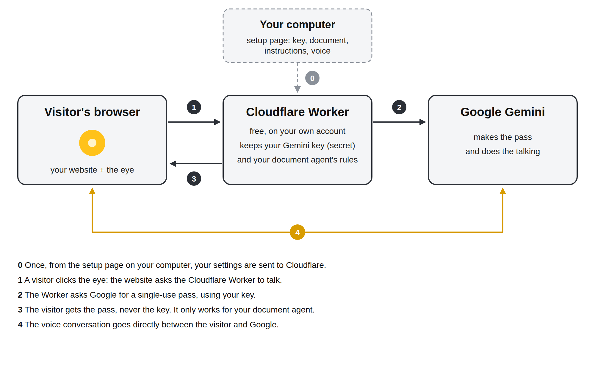

# Generic Document Agent

A talking AI agent for any document, on any website. You give it one document (a manual, a CV, a menu, a policy, a
course handout...) and a few instructions saying who the agent is and what it should and should not talk about.
Visitors click a glowing yellow eye in the corner of your site, allow the microphone, and ask about the document out
loud. A Gemini voice answers, using only that document.

- It stays on the document. Whatever your instructions say, it politely declines anything the document does not
  cover, and it never invents facts.
- Voice only, hands-free: visitors can interrupt it, and it shows captions as it talks.
- English is spoken with a British accent, and Spanish with an accent from Spain. It speaks English unless the visitor
  speaks another language.
- Your Gemini key never reaches your website or your visitors.
- Free to run on Google's free Gemini tier and Cloudflare's free plan, so your computer does not need to stay on.
- One line of HTML to add it to any website.
- **One setup is one agent.** For a second agent (another document), run another copy of this project with a
  different worker name. Using the same Gemini key and Cloudflare account for both is your choice.

## Contents

1. [How it works](#how-it-works)
2. [Requirements](#requirements)
3. [Quick start with Docker](#quick-start-with-docker) (recommended)
4. [Get a free Gemini key](#1-get-a-free-gemini-key)
5. [Install](#2-install)
6. [Start it](#3-start-it)
7. [Set it up](#4-set-it-up)
8. [Try it](#5-try-it)
9. [Add it to your website](#6-add-it-to-your-website)
10. [Put it on Cloudflare](#7-put-it-on-cloudflare)
11. [Keep it running](#8-keep-it-running)
12. [Settings reference](#settings-reference)
13. [Updating](#updating)
14. [Troubleshooting](#troubleshooting)
15. [Privacy and security](#privacy-and-security)
16. [For developers](#for-developers)
17. [Licence](#licence)

## How it works



- The **setup page** runs on your own computer (a small Node.js program in this project). There you paste your
  Gemini key, add your document and instructions, choose a voice, and press **Send to Cloudflare**. Your computer is only needed
  when you change the settings.
- That button puts a small program, a **Cloudflare Worker**, on your own free Cloudflare account. It keeps your
  Gemini key as an encrypted secret, along with your assistant's rules, and serves the widget to your website.
- When a visitor clicks the eye, the Worker checks that the request comes from a website you allowed and that your
  limits are not reached, then asks Google for a **pass** (an ephemeral token). The pass works once, must be used
  within a minute, lasts one conversation, and is locked to your document, the agent's rules and your chosen voice.
- The visitor's browser uses the pass to talk to **Gemini Live** directly, so the conversation's audio never passes
  through Cloudflare or your computer, and nothing stores it.

## Requirements

- A computer to set it up on: Linux, macOS or Windows. It only has to stay on if you do not use Cloudflare (step 7).
- **Node.js 22 or newer**, with npm. Check with `node --version`. Download from <https://nodejs.org/>.
- **Git**, to download the project (or download it as a ZIP from the repository page).
- A **Google account**, for the free Gemini key.
- Your **document** as a PDF, a text file or a Markdown file.
- To put it on a public website: a free **Cloudflare** account (see step 7). No domain name is needed.
- Optional, for developers only: Google Chrome (browser checks) and ffmpeg (to remake the voice samples).

With Docker you need only **Docker** (with Docker Compose) instead of Node.js: see the next section.

## Quick start with Docker

Docker runs the assistant in a container, with nothing else to install. You need Docker with Docker Compose
(<https://docs.docker.com/get-docker/>; check with `docker compose version`).

**1. Get the project and start it.** In a terminal:

```bash
git clone https://github.com/jmsalash/generic-document-agent.git
cd generic-document-agent
docker compose up -d --build
```

This builds the image (the first time takes a minute) and starts a container called `document-agent` in the background. It
restarts by itself after a reboot, until you stop it.

**2. Check it is running:**

```bash
docker compose ps        # STATUS should say "Up" (and "healthy" after a few seconds)
docker compose logs      # should show "Document agent relay on http://0.0.0.0:8792"
```

**3. Open the setup page** in a browser on the same computer: <http://localhost:8792/setup>
(from another device at home: `http://<computer's address>:8792/setup`).

Then follow [step 4, Set it up](#4-set-it-up): paste your Gemini key ([get one free](#1-get-a-free-gemini-key)), add
your document and instructions, the websites allowed to use it, and a voice, and press **Save**. The top of the
page says **Ready** when it can talk.

**4. Try it:** open <http://localhost:8792/> and click the yellow eye ([step 5](#5-try-it)). From a phone, open
`http://<computer's address>:8792/`: you are sent to the secure address on port 8793; accept the certificate warning
once.

**5. Put it on Cloudflare and on your website:** follow [step 7](#7-put-it-on-cloudflare) and
[step 6](#6-add-it-to-your-website).

### Everyday Docker commands

Run these in the project folder:

| To | Run |
| --- | --- |
| Stop it | `docker compose stop` |
| Start it again | `docker compose start` |
| See what it is doing | `docker compose logs -f` (Ctrl-C to leave) |
| Update to a newer version | `git pull` then `docker compose up -d --build` |
| Remove the container (keeps your settings) | `docker compose down` |
| Remove everything, including your key and document | `docker compose down -v` |


Your key, document and settings are kept in a Docker volume called `document-agent-data`, not inside the container, so stopping,
updating or recreating the container keeps them. Back them up with
`docker run --rm -v generic-document-agent_document-agent-data:/data -v "$PWD":/backup alpine tar czf /backup/document-agent-data.tgz -C /data .`
(the volume name is the folder name followed by `_document-agent-data`; `docker volume ls` shows it).

### Without Docker Compose

```bash
docker build -t generic-document-agent .
docker run -d --name document-agent --restart unless-stopped \
  -p 8792:8792 -p 8793:8793 -v document-agent-data:/app/data generic-document-agent
```

Keep the ports the same on both sides (`8792:8792`, `8793:8793`): the page that sends phones to the secure address
uses port 8793. To use other ports, change both sides and set the variables to match, for example
`-p 9000:9000 -p 9001:9001 -e PORT=9000 -e HTTPS_PORT=9001`.

### If something is wrong

- `docker compose ps` shows nothing: it is not running; start it with `docker compose up -d`.
- "port is already allocated": something else uses 8792 or 8793. Stop it, or change the ports as above.
- The setup page says "not found": it only opens from your own computer or home network.
- For anything else, see [Troubleshooting](#troubleshooting) and `docker compose logs`.

## 1. Get a free Gemini key

1. Open <https://aistudio.google.com/apikey> and sign in with your Google account.
2. Choose **Create API key** and copy it.
3. Keep it private: you will paste it into the setup page in step 4, and nowhere else.

The free tier is enough. It has daily limits; a paid key only raises them and is optional. If you add billing to the
Google project, Google may charge for use above the free tier, so set a budget alert in Google Cloud if you do.

## 2. Install

(Skip steps 2, 3 and 8 if you use [Docker](#quick-start-with-docker).)

```bash
git clone https://github.com/jmsalash/generic-document-agent.git
cd generic-document-agent
npm install
```

`npm install` downloads two libraries: Google's Gemini SDK (`@google/genai`) and `selfsigned` (which makes the HTTPS
certificate).

## 3. Start it

```bash
npm start
```

You should see:

```
Document agent relay on http://0.0.0.0:8792
Document agent relay on https://0.0.0.0:8793 (self-signed)
```

It listens on every network address of the computer:

| Address | What it is |
| --- | --- |
| `http://localhost:8792/setup` | Setup page (only from this computer or your home network) |
| `http://localhost:8792/` | Demo page with the document and the eye |
| `https://<computer's address>:8793/` | The same over HTTPS, for phones and other computers at home |
| `/widget.js` | The script your website loads |
| `/health` | Whether it is ready: `{"ok":true,...}` |

Stop it with Ctrl-C. To use other ports, start it with `PORT=9000 HTTPS_PORT=9001 npm start`.

On first start it creates a `data/` folder with a self-signed certificate. Everything you set is saved there, so
restarts keep it. Never share or commit the `data/` folder: it holds your key.

## 4. Set it up

Open `http://localhost:8792/setup` (or `http://<computer's address>:8792/setup` from another device at home) and fill in:

1. **Gemini key**: paste the key from step 1.
2. **Agent name** (optional): how the agent calls itself, for example "the Acme manual helper".
3. **Your document**: upload a PDF, text or Markdown file (20 MB at most). Gemini turns a PDF into text (this can take
   up to a minute); the text then appears in the box below, where you can check and correct it. You can also paste the
   text directly. For a PDF you can fill in **from page** and **to page** to use only part of it, for example to skip
   the index or a glossary, or to make an agent for one chapter. Changing the pages and pressing Save reads the saved
   PDF again, without uploading it again. On Save the text is counted in tokens. The free Gemini plan takes up to 32,000
   tokens (about 24,000 words, or 50 pages): above 30,000 the page warns you, and above 32,000 the end of the document
   is cut off, with a warning saying how much was kept.
4. **Instructions for the agent**: what the agent is for, its tone, what to stress, and any **extra facts** it may
   share beyond the document (for example "if someone asks about my favourite food, it is paella"). Everything that is
   neither in the document nor added here is off limits, and that rule is built in: the instructions cannot remove it.
   The agent also always says it is an AI. The box starts with an example for a CV website; rewrite it for your
   document.
5. **Websites allowed to use it**: one address per line, for example `https://yoursite.com` (add
   `https://www.yoursite.com` too if you use it). Pages on your home network are always allowed, for testing.
6. **Voice**: choose one and press **Listen** to hear a sample. Only the voices that kept a British English accent and
   a Spain Spanish accent in testing are offered.
7. **Limits**: see [Settings reference](#settings-reference). The defaults are fine to start.

Press **Save**. The top of the page says **Ready** when the key and document are set; until then it says what is missing.

## 5. Try it

- On the computer running it: open `http://localhost:8792/`, click the yellow eye, allow the microphone, and ask a
  question such as "What did they do in their last job?".
- From a phone or another computer at home: open `http://<computer's address>:8792/`. You are sent to the HTTPS
  address automatically, because browsers only allow the microphone on secure pages. The first time, the browser warns
  about the certificate (it is self-signed): choose to continue.

The eye introduces itself first (it says it is an AI and can make mistakes), then listens. Talk over it to interrupt
it. Press **end**, click the eye, or switch tabs to finish; the microphone is always switched off.

## 6. Add it to your website

Once it is on Cloudflare (step 7), the setup page shows the line to paste into your website's pages, for example
just before `</body>`:

```html
<script type="module" src="https://document-agent.YOURNAME.workers.dev/widget.js"></script>
```

If your website had an older line for this assistant (for example one pointing at a tunnel address), replace it with
this one. Your website's address must be in "Websites allowed to use it" on the setup page. It works from any website
host, including GitHub Pages.

**Alternative: copy the widget onto your website.** Copy the project's `widget/` folder to your site, for example as a
folder called `document-agent`, and use this line instead:

```html
<script type="module" src="/document-agent/main.js" data-relay="https://document-agent.YOURNAME.workers.dev"></script>
```

This way the eye still appears (grey, "Assistant is offline") if the assistant cannot be reached, and turns yellow
again by itself within about 30 seconds. After updating the project, copy the `widget/` folder again.

The eye is fixed to the top-right corner, does not cover your content when the page loads, and hides its label once
the page is scrolled. It matches a dark site by default; to restyle it, set any of these CSS variables on your page:

```css
:root {
  --cva-eye: #ffc21a;   /* eye colour */
  --cva-ink: #E8EAE6;   /* main text, and the banner's background */
  --cva-paper: #101318; /* the banner's text */
  --cva-card: #171B21;  /* captions card */
  --cva-line: #2A2F36;  /* borders */
  --cva-slate: #98A1AC; /* secondary text */
  --cva-live: #ff6b5e;  /* "mic on" */
  --cva-link: #ffc21a;  /* links */
}
```

## 7. Put it on Cloudflare

This step involves creating accounts and a token on Cloudflare. It is written step by step, but if you are not
comfortable with this kind of setup, you will most probably want help from someone technical the first time.

Your website is public, so visitors' browsers must reach the assistant over HTTPS from the internet. One button on the
setup page copies the part visitors use to your own free Cloudflare account, as a **Cloudflare Worker**. After that
your computer can be off: it is only needed to change the settings. No domain name is needed, and your website can be
hosted anywhere, for example on GitHub Pages.


What goes to Cloudflare: the widget, the demo page, your Gemini key (as an encrypted secret that cannot be read back,
even by you in the dashboard), the agent's rules built from your document and instructions, your voice, your allowed websites and your limits. The setup page, the document file and the Cloudflare token stay on your computer.

1. Create a free account at <https://dash.cloudflare.com/sign-up>. The free plan is enough (100,000 requests a day;
   a small website uses a tiny fraction).
2. In the dashboard open **Workers & Pages** (under Compute) once, and when asked choose your free **workers.dev**
   name, for example `yourname`. Your assistant's address will be `https://document-agent.yourname.workers.dev`.
3. Copy your **Account ID**: it is shown on the Workers & Pages page, and in the menu next to your account's name on
   Account home.
4. Create a token: click your profile icon → **My Profile** → **API Tokens** → **Create Token**. Next to
   **Edit Cloudflare Workers** choose **Use template**. Under Account Resources choose your account, and under Zone
   Resources choose **All zones** (nothing on your zones is changed). Then **Continue to summary** → **Create Token**,
   and copy the token. Cloudflare shows it only once.
5. Start the assistant on your computer and open the setup page. In the **Cloudflare** box, choose a **Worker name**
   (lowercase letters, numbers and dashes; `document-agent` by default). Each agent needs its own name, which becomes
   part of its address: `https://<worker name>.yourname.workers.dev`. Paste the Account ID and the token, and press
   **Send to Cloudflare**. After a few seconds the page shows your address and the line to paste
   on your website.
6. Make sure your website's address (for example `https://yourname.github.io`) is in **Websites allowed to use it**,
   and press Save. From now on every Save also updates Cloudflare.
7. Open the address it shows to try the demo page, then add the line to your website (step 6). Your computer can
   now be off.

If you change the worker name later and Save, the agent moves to the new address and the old Worker is deleted;
update the line on your website. **Remove from Cloudflare** on the setup page deletes it from your account again. If an update fails, the setup page
says why (for example a token without the right permission), and your settings on the computer are kept.


### If it does not work

| What you see | What to do |
| --- | --- |
| "The Cloudflare token was not accepted" | Create the token again from the **Edit Cloudflare Workers** template (step 4), with your account and All zones. |
| "That Cloudflare account ID was not found" | Copy the Account ID again (step 3). |
| "Choose your free workers.dev name in Cloudflare first" | Open **Workers & Pages** in the dashboard once and choose the name (step 2). |
| `https://document-agent.yourname.workers.dev/health` shows `"ok":false` | Add your Gemini key and document on the setup page, and Save. |
| `/health` works but the eye is grey on your website | Your website's exact address (with `https://`, and `www.` if used) is missing from "Websites allowed to use it". Add it and Save. |
| The eye does not appear at all | Check the script line's address, and your browser's console for errors loading `widget.js`. |

## 8. Keep it running

Once it is on Cloudflare (step 7) there is nothing to keep running: start the relay only when you want to change the
settings. Without Cloudflare, the eye only works while the relay runs. When it is off, the eye turns grey and says "Assistant is offline", then
turns yellow again by itself when the relay is back.

To start it automatically, use your system's service manager. On Linux with systemd, for example, create
`~/.config/systemd/user/document-agent.service`:

```ini
[Unit]
Description=Generic Document Agent

[Service]
WorkingDirectory=/path/to/generic-document-agent
ExecStart=/usr/bin/env node relay/server.js
Restart=on-failure

[Install]
WantedBy=default.target
```

then run `systemctl --user enable --now document-agent` (and `loginctl enable-linger $USER` so it keeps running when you are
logged out). On macOS use a LaunchAgent; on Windows, Task Scheduler ("At startup", running `node relay\server.js` in
the project folder). The relay stops cleanly when the service manager stops it.

## Settings reference

| Setting | Default | What it does |
| --- | --- | --- |
| Conversations at once | 3 | More visitors than this see "Busy with visitors, try soon". 3 is the most a free Gemini key allows; a paid key allows many more (Google does not publish a fixed number; AI Studio shows your limits). |
| Minutes per conversation | 10 | A conversation ends after this ("Time's up. Click to talk again"). |
| Per visitor per hour | 10 | Conversations one visitor can start in an hour. |
| Per day | 200 | Conversations in total per 24 hours, to protect your free Gemini allowance. |

Environment variables: `PORT` (8792), `HTTPS_PORT` (8793), `DATA_DIR` (`./data`).

The Gemini models are set in `relay/gemini.js`: `LIVE_MODEL` for conversations and `TEXT_MODELS` for reading PDFs.
Google renames and retires models from time to time. If conversations stop working and the relay's output shows a
"not found" error, set `LIVE_MODEL` to the current Live model listed at <https://ai.google.dev/gemini-api/docs/models>.

## Updating

```bash
git pull
npm install
```

Then restart the relay. Your settings in `data/` are kept.

## Troubleshooting

| What you see | Why, and what to do |
| --- | --- |
| Grey eye, "Assistant is offline" | The relay is not running, the key or document is missing (the setup page says which), or your website is not in the allowed list. |
| The eye greys out when clicked | Usually the page was opened over plain `http://` from another device, and the browser blocks the microphone. Use the HTTPS address. |
| "Needs a secure (https) page" | As above: open the page over `https://`. |
| "Microphone needed to talk" | The visitor refused the microphone. They can allow it from the browser's address bar. |
| "Busy with visitors, try soon" | A limit is reached. Raise it on the setup page if you like. |
| The setup page shows "not found" | It only opens from the computer itself or your home network, never from the internet. |
| "Gemini could not read that file (the key was not accepted)" | Check the key at <https://aistudio.google.com/apikey>. |
| "... (the free daily limit is used up for now)" | Wait for the daily reset, or use a paid key. |
| A PDF cannot be read | Paste the document text into the box instead. |
| Certificate warning on phones | Expected at home with the self-signed certificate: choose to continue. Through the Cloudflare address there is no warning. |

The relay prints what it does (saves, failed requests, stops) in the terminal or the service log. It never prints
your key.

## Privacy and security

- Your Gemini key and document stay in `data/` on your computer, readable only by your user. The key is never sent to
  browsers; visitors only receive single-use passes.
- With Cloudflare Workers, the key is stored on your Cloudflare account as an encrypted secret, and the assistant's
  instructions (which contain your document text) as a setting of your Worker. Your Cloudflare token stays in `data/` and
  is only sent to Cloudflare's API.
- Passes are locked: a visitor cannot change the assistant's instructions, model or voice, and cannot reuse a pass.
- Only websites you list can get passes. The setup page only answers on your own network.
- Visitors' audio goes from their browser to Google, not through your computer, and the relay stores no conversations.
  Google's terms for the Gemini API apply to that audio: <https://ai.google.dev/gemini-api/terms>. On the free tier
  Google may use the content to improve its products; a paid key changes that.
- The widget always shows "AI voice · not a live person · can make mistakes", and the assistant says so out loud first.

## For developers

```
relay/      the relay: server.js (start), app.js (routes), token.js (locked passes), document.js (document reading and
            the agent's instructions), limits.js, store.js, net.js, pages.js (setup and demo pages), voice.js, cert.js
cloud/      the Cloudflare Worker: handler.js (routes), worker.js (entry and the Limiter Durable Object),
            deploy.js (uploads it through Cloudflare's API, run from the setup page)
widget/     the eye: plain JavaScript modules, no build step (main.js is served as /widget.js)
voices/     ready-made voice samples played by the setup page
scripts/    make-voice-samples.mjs: remakes the samples with the saved key (needs ffmpeg)
tests/      unit and integration tests, a headless-Chrome check, and a live check against Gemini
docs/       design and build notes
Dockerfile, docker-compose.yml   the container (data in the document-agent-data volume, mounted at /app/data)
```

- Tests: `npm test`.
- Browser checks (need Google Chrome; set `CHROME` if it is not at `/usr/bin/google-chrome`):
  `node tests/browser/check.mjs` (layout) and `node tests/browser/offline-check.mjs` (grey eye when the relay is
  unreachable, yellow again when it returns).
- Live check with your saved key: `node tests/live/live-check.mjs`. Add `--sample` to use a built-in kettle manual
  instead and check that it answers about it, shares a fact added in the instructions, and declines a poem
  (`SAMPLE_INSTRUCTIONS` sets other instructions to try; `GEMINI_KEY` overrides the saved key). Add `--browser question.wav` (a 16-bit mono WAV
  recording of a spoken question, a few seconds long) for a full spoken turn in headless Chrome.
- Remake the voice samples: `node scripts/make-voice-samples.mjs [Voice ...]`. Each take is checked by Gemini and kept
  only when it is heard as British.

## Licence

MIT. See [LICENSE](LICENSE).
